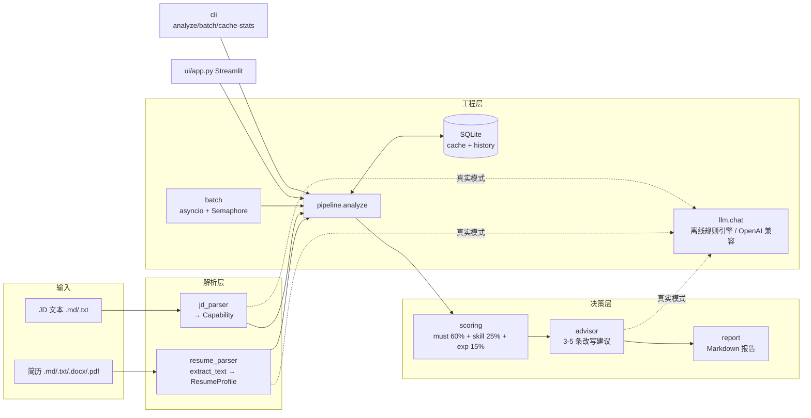

# AI 简历—岗位匹配助手（初版 V1）

[](https://github.com/QinHuai00/ai-resume-matcher/actions/workflows/tests.yml)


> 一句话定位：把一段 JD 和一份简历，变成**可解释的匹配分 + 缺失技能清单 + 可直接照改的改写建议**。
>
> 这是项目的**初版 V1**：**默认离线可跑**（无网络、无 API Key、不装任何第三方包也能演示和评测），
> 配置 `.env` 后自动切换到真实大模型，**两条路径共用同一套代码**。
> 从 V1 到进阶版的优化路线（结构化输出 → 语义匹配 → 权重校准 → 批量成本 → 交付）
> 见 [`docs/roadmap.md`](docs/roadmap.md)。

---

## 1. 快速开始（离线，5 分钟）

**环境**：Windows / Linux / macOS + Python 3.10+（开发环境 3.14）。离线模式只用标准库，
`numpy` / `python-docx` 有则增强、没有也能跑；因此下面 3 条命令**不需要安装任何第三方库，也不需要联网**。

```bash
cd ai-resume-matcher   # 克隆后的项目根目录

# 1) 分析一组：AI 应用开发实习 JD × 张沐阳简历（会打印完整报告）
python -m app.cli analyze --jd data/samples/jd_ai_app.md --resume data/samples/resume_zhang.md --out match_report.md

# 2) 跑单元测试（45 个用例，标准库 unittest）
python -m unittest discover -s tests -v

# 3) 跑评测：MAE / 稳定性 / 结构化成功率
python eval/run_eval.py
```

第 1 条命令的真实输出（2026-10-18 实测，下同）：

```text
[OFFLINE] 岗位：AI 应用开发实习生（LLM 应用方向）
候选人：张沐阳
总分：75 / 100
├─ 硬性要求命中  6/7 (86%)   权重 60%
├─ 技能覆盖      10/12 (83%)   权重 25%
└─ 经历相关度    0.05           权重 15%
缺失技能：langchain、高并发
未命中硬性要求：1 条
模式：offline（未配置 SF_API_KEY（无 .env 或值为空）） ｜ 缓存：未命中 ｜ 耗时：3 ms ｜ Prompt：v1
```

换一份“错配”的样本，分数会明显掉下来（证明评分不是摆设）：

```bash
# 数据分析简历投 AI 应用开发岗 → 22 分，缺失 fastapi/rag/向量检索 等
python -m app.cli analyze --jd data/samples/jd_ai_app.md --resume data/samples/resume_li.md --no-cache

# 数据分析强匹配 → 83 分
python -m app.cli analyze --jd data/samples/jd_data_analyst.md --resume data/samples/resume_li.md --no-cache
```

其它常用命令：

```bash
# 批量并发分析 eval/pairs.csv（asyncio + Semaphore，离线也能跑）
python -m app.cli batch --pairs eval/pairs.csv --concurrency 4

# 缓存与历史统计（缓存键含 PROMPT_VERSION，命中率可观察）
python -m app.cli cache-stats

# 只生成报告文件（默认 match_report.md）
python -m app.cli report --jd data/samples/jd_ai_app.md --resume data/samples/resume_zhang.md --out report.md
```

> 路径全部以**项目根**为基准解析，因此从任意目录执行 `python -m app.cli ...` 也能找到 `data/samples`；
> 只有 `--out` 的相对路径按“当前工作目录”算（这是命令行工具的惯例）。

---

## 2. 接真实模型（可选，`.env` 自动切换）

本次交付环境**没有配置 API Key**，所以真实模式只做了代码实现与降级验证；能联网、有 Key 的机器上按下面两步即可切换：

1. 安装依赖（只装需要的即可）：`pip install openai python-docx pypdf streamlit`
2. 复制配置并填 Key：

```bash
Copy-Item .env.example .env
# 编辑 .env：
#   SF_API_KEY=sk-你的key
#   SF_BASE_URL=https://api.siliconflow.cn/v1
#   CHAT_MODEL=Qwen/Qwen2.5-7B-Instruct
```

切换逻辑（`app/config.py` 的 `OFFLINE` 判定）完全自动，**业务代码不用改**：

| 场景 | 行为 |
|------|------|
| 没配 `SF_API_KEY` | `OFFLINE=True`，走离线规则引擎，输出带 `[OFFLINE]` |
| 配了 Key 但没装 `openai` | `OFFLINE=True`，提示「已配置 SF_API_KEY，但未安装 openai SDK」 |
| 配了 Key 且装了 `openai` | `OFFLINE=False`，JD/简历/建议走大模型，失败或输出不合法自动降级规则引擎 |
| 设了 `RESUME_MATCHER_OFFLINE=1` | 强制离线（演示/评测时排除网络波动） |

真实模式里已经落实的工程点：

- **重试**：`app/llm.py` 只对 429/5xx/超时重试，退避 1s → 2s → 4s；401/400 直接失败（重试无意义）；
- **日志**：每次调用记录 attempt、耗时、token usage；失败降级会写 warning，报告尾部标 `mode`；
- **结构化输出**：`response_format={"type":"json_object"}` + Prompt 内 JSON 字段说明 + `validate_dict` 手工校验，
  校验错误**回灌给模型**重写（最多 2 次），仍失败则降级规则引擎；
- **缓存键带版本**：`md5(PROMPT_VERSION | jd | resume)`，改 Prompt 必须改 `PROMPT_VERSION`，避免旧结果被命中。

---

## 3. 架构



**数据流**：`JD → Capability` + `简历 → ResumeProfile` → 三维评分 → 缺失技能/差距 → 改写建议 → Markdown 报告
→ 结果写入 SQLite 缓存（下次同内容直接命中）。

### 工程亮点（面试可展开的点）

| 设计 | 原因 |
| --- | --- |
| **离线规则引擎 + 真实 LLM 双模式** | 没有 Key 也能完整演示与评测；配 `.env` 自动切换，失败自动降级，接口不中断 |
| **可解释评分** | 60/25/15 三维公开权重，每个分数能手算、能追溯到具体命中的要求与技能 |
| **缓存键含 Prompt 版本** | `md5(PROMPT_VERSION｜jd｜resume)`，改 Prompt 必然失效旧缓存，避免"改了没生效"的隐蔽 bug |
| **结构化输出三层保障（真实模式）** | JSON 模式 + 字段 Schema + 手工校验，校验错误回灌模型重写，仍失败降级规则引擎 |
| **并发限流批量** | `asyncio.Semaphore` + `to_thread`，单条失败不影响整批，防 429 |
| **零第三方依赖可测** | 45 个 unittest 只依赖标准库，CI 上直接跑，不需要装包 |

---

## 4. 目录说明

```text
resume-matcher/
├─ app/
│  ├─ config.py          # 路径、权重、Prompt 版本、.env 解析、离线判定
│  ├─ llm.py             # 统一 chat()：重试/日志/JSON 模式；离线抛 OfflineLLMError
│  ├─ schemas.py         # Capability / ResumeProfile / MatchResult（dataclass + 手工校验）
│  ├─ jd_parser.py       # JD → Capability；技能词表、年限/学历抽取
│  ├─ resume_parser.py   # 文件 → 文本 → ResumeProfile；缺库中文提示
│  ├─ scoring.py         # 纯函数三维评分 + 缺失技能
│  ├─ advisor.py         # 3-5 条改写建议（LLM / 离线模板）
│  ├─ store.py           # SQLite 缓存 + 历史；make_key 含 PROMPT_VERSION
│  ├─ report.py          # Markdown 报告
│  ├─ pipeline.py        # analyze(jd, resume) → dict（缓存命中/未命中）
│  ├─ batch.py           # asyncio 并发批量
│  └─ cli.py             # analyze / report / batch / cache-stats
├─ data/samples/         # 2 份 JD + 2 份简历（虚构、脱敏、一栏式）
│  └─ variants/          # 3 份简历变体，用于凑齐 10 组评测样本
├─ eval/
│  ├─ labels.csv         # 10 组人工标注（jd, resume, human_score）
│  ├─ pairs.csv          # 批量清单
│  └─ run_eval.py        # MAE / 稳定性 / 结构化成功率
├─ tests/                # unittest：评分纯函数、解析边界、流水线契约、稳定性
├─ ui/app.py             # Streamlit 网页版（未装 streamlit 时打印提示退出）
├─ .env.example / .gitignore / requirements.txt
└─ README.md
```

---

## 5. 评分设计（每个数字都能解释）

```text
总分 = 60% × 硬性要求命中率 + 25% × 技能覆盖率 + 15% × min(经历相关度 × 3, 1)
```

| 维度 | 算法（`app/scoring.py`） | 权重 | 为什么这么设计 |
|------|--------------------------|------|----------------|
| 硬性要求命中率 | 逐条判断：要求的 token（中文 2-4 字滑窗 + 英文单词）在「简历全文 + 技能列表」里的重叠是否 ≥ 1/3 | 60% | 硬性要求不过关，简历再漂亮也白搭 |
| 技能覆盖率 | `len(JD技能 ∩ 简历技能) / len(JD技能)`，技能来自内置中英词表 | 25% | 集合运算，客观、可复现、缺什么一眼可见 |
| 经历相关度 | JD 要求/技能 与 简历项目描述 的 token Jaccard，×3 后截断到 1 | 15% | 衡量“做过的事是否对得上”；Jaccard 天然偏小所以放大 |

设计取舍（面试会被问）：

- 不让模型“直接打个 0-100 分”：那样不可复现也不可解释。三维拆分后每个分数都能手算；
- **匹配前会剔除模板词**（`及以上 / 相关 / 具备 / 能独立 / 至少 / 其他 / 能力` 等），否则“本科及以上学历”
  会被滑窗分词生成一堆无意义 n-gram，把真实命中稀释成未命中；
- `min(rel × 3, 1)`：两个几千 token 的集合做 Jaccard，值天然只有 0.01-0.1，不放大这一维几乎不起作用；
- 缺失技能同时进“技能覆盖”和“改写建议”，报告里可以直接照抄去改简历。

**重要坦白**：经历相关度这一维在 V1 里是**最弱的一维**（实测原始值 0.004-0.085，×3 后对总分贡献 0-5 分），
因为它只是词面重叠、没有语义。V2/V3 会把它换成 embedding 向量相似度（复用项目一的 embedding 能力），
见 [`docs/roadmap.md`](docs/roadmap.md) 的 V2→V3。

---

## 6. 评测方法（怎么证明它“不是瞎打分”）

`eval/labels.csv` 有 **10 组**（2 份 JD × 5 份简历）人工分：JD 里每条要求逐条对照简历给出判断，
分数是“能不能投”的量级估计（0-100），**不是行业金标**，只用于发现明显偏差。

```bash
python eval/run_eval.py
```

实测结果（2026-10-18，离线模式）：

| 指标 | 结果 | 验收要求 |
|------|------|----------|
| MAE（与人工分平均绝对误差） | **6.5 分**（10 组） | 没有硬指标，越小越好 |
| 稳定性（同输入跑 3 次总分） | **[75, 75, 75]，极差 0** | < 5 |
| 结构化成功率（Capability/ResumeProfile 通过校验） | **100%**（10/10） | 真实模式下应 ≥ 95% |
| 单组平均耗时 | 1.4 ms（离线规则引擎） | — |

10 组明细（系统分 vs 人工分）：

| JD | 简历 | 系统 | 人工 | 误差 |
|----|------|------|------|------|
| AI 应用开发 | 张沐阳（强匹配） | 75 | 80 | 5 |
| AI 应用开发 | 李知遥（数据分析） | 22 | 30 | 8 |
| AI 应用开发 | 张沐阳（基础版） | 33 | 28 | 5 |
| AI 应用开发 | 李知遥（后端版） | 58 | 65 | 7 |
| AI 应用开发 | 李知遥（资深数据） | 13 | 20 | 7 |
| 数据分析 | 张沐阳 | 17 | 25 | 8 |
| 数据分析 | 李知遥（强匹配） | 83 | 88 | 5 |
| 数据分析 | 张沐阳（基础版） | 14 | 20 | 6 |
| 数据分析 | 李知遥（后端版） | 14 | 22 | 8 |
| 数据分析 | 李知遥（资深数据） | 86 | 92 | 6 |

**这套评测能在真实模式复跑**：把 `.env` 配好后再执行同一命令，比的就是真实模型的 MAE 与结构化成功率；
离线数字不能当真实模型指标（报告里会显式标注模式）。

想加自己的样本：把 JD/简历放进 `data/samples/`，在 `eval/labels.csv` 加一行 `jd,resume,human_score,note` 即可。

---

## 7. 已知局限（先承认，再优化）

1. **关键词匹配漏同义表述**：“容器化”与 Docker、“大模型”与 LLM 做了别名归一，但“向量库”与“向量数据库”、
   “埋点”与“数据上报”这类仍会漏；词表外的技能（如 Rust、Vue）直接漏判。
2. **两栏简历会串行**：解析按行读，两栏模板抽出来的文本顺序会乱，导致经历相关度偏低；一栏式准确率高。
   这是初版的硬边界，不在 V1 做坐标重排（优化文档里讲）。
3. **经历相关度太弱**：纯词面 Jaccard，语义近但不共享词的描述会得 0 分（见第 5 节）。
4. **PDF 依赖 pypdf**：未安装时 PDF 简历会提示“安装 pypdf 或改用 .docx/.txt”；扫描件/图片 PDF 即使装了也抽不出文本（`MIN_TEXT_LEN=100` 会拦下）。
5. **人工标注只有 10 组且是自标注**：MAE 只能说明“没有明显离谱”，不能证明绝对准确。
6. **规则引擎不是通用 NLP**：JD 写法特别口语化/表格化时，`must_have` 可能抽漏或抽多；真实模式更稳，但需要 Key。
7. **旧版 `.doc` 不支持**：二进制格式，请另存为 `.docx`。
8. **离线结果 ≠ 真实模型效果**：离线是确定性规则输出，`[OFFLINE]` 标签与报告尾部都会标注。

---

## 8. 下一步：从初版到进阶版

完整的优化路线（问题 → 假设 → 改法 → 实验 → 结论）见 [`docs/roadmap.md`](docs/roadmap.md)。
每级的初版接口/缺口如下：

| 级别 | 主题 | 初版留下的接口/缺口 |
|------|------|----------------------|
| V1→V2 | 结构化输出稳定性（JSON 模式 + schema + 校验 + 错误回灌 + 降级） | `app/llm.py::chat`、`app/jd_parser.py::parse_jd` 的校验回灌循环、`schemas.validate_dict` |
| V2→V3 | 匹配质量（同义词/技能归一化、复用项目一 embedding 做语义匹配、`must_have` 判定升级） | `app/config.py::SKILL_PATTERNS`、`app/scoring.py::must_hit_rate` |
| V3→V4 | 权重校准（20-50 份人工标注、网格搜索/坐标下降、MAE 前后对比、防过拟合） | `app/config.py::WEIGHTS`、`eval/labels.csv` |
| V4→V5 | 批量与成本（Semaphore 并发、缓存命中率、Prompt 版本化、批量任务容错） | `app/batch.py`、`app/store.py` |
| V5→V6 | 体验与交付（进度反馈、报告下载、失败重试、演示脚本） | `ui/app.py`、`app/cli.py` |

---

## 9. 工程约定与排错

- 所有中文输出显式 UTF-8：CLI 启动时 `sys.stdout.reconfigure(encoding="utf-8", errors="replace")`，文件读写 `encoding="utf-8"`；
- 业务日志用 `logging`（时间 + 模块名），面向用户的报告用 `print`/Markdown；
- 不写死绝对路径：数据目录一律由 `Path(__file__).resolve().parents[1]` 推导；
- 单文件 ≤ 300 行，模块职责单一；
- 标准库优先：`schemas.py` 用 dataclass 而不是 Pydantic（离线模式零依赖），接口保持 `to_dict / from_dict / validate_dict`，
  真实项目可整体替换为 Pydantic v2。

常见问题：

| 现象 | 原因 / 解决 |
|------|-------------|
| 控制台中文乱码 | 用 Windows Terminal / PowerShell 7；代码已强制 UTF-8，老版 cmd 请先 `chcp 65001` |
| `未安装 streamlit，网页版不可用` | 正常降级；离线演示用 CLI 即可，装了之后 `streamlit run ui/app.py` |
| `解析 PDF 需要 pypdf` | 没装 pypdf；改用 `.docx`/`.txt`/`.md`，或联网后 `pip install pypdf` |
| 改了 Prompt 但分数没变 | `PROMPT_VERSION` 没改，命中了旧缓存；改版本号或 `--no-cache` |
| 分数和上次不一样 | 离线规则引擎是确定性的，真实模式受模型随机性影响；报告尾部有 `mode` 与耗时 |
| `结果文件不存在` | 路径按项目根解析，请确认在项目根目录下执行/用示例里的相对路径 |

---

## 10. 数据与隐私

`data/samples/` 里的姓名（张沐阳、李知遥）、公司、电话、邮箱全部为**虚构**，电话用 `138-0000-0000（虚拟）`，
邮箱用 `example.com` 域名；仅用于演示与评测，不含任何真实个人信息。换成自己的简历时注意不要提交 `.env` 与真实联系方式。

## 许可证

MIT License，见 [LICENSE](LICENSE)。示例 JD / 简历数据均为虚构，可自由用于演示。
